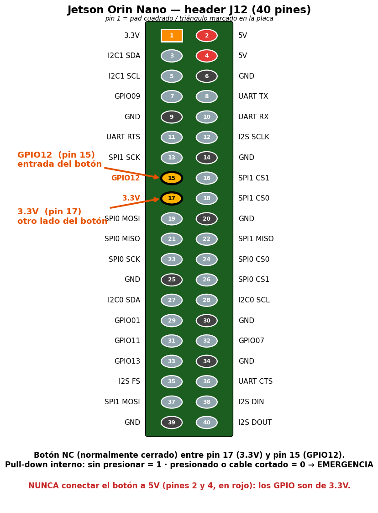

# Seta de parada de emergencia de Milo

La seta física (botón tipo hongo) frena las ruedas **al instante**, sin rampa. La lee el propio
driver de las ruedas (`hoverboard_bridge`), así que funciona en **todos** los modos que usan
`driver:=bridge` (mapeo, navegación, solo robot) aunque el panel esté cerrado.



## Conexión

| Seta (contacto **NC**, normalmente cerrado) | Header de 40 pines de la Jetson |
|---|---|
| un borne | pin **1** (3,3 V) |
| el otro borne | pin **7** (GPIO09 = PAC.06 = `gpiochip0` línea **144**) |

Por qué NC: con la seta suelta el circuito está cerrado y el pin lee **1**. Al presionarla se
abre y el pin cae a **0**. Si un cable se corta o se suelta, también cae a 0, así que **un cable
roto frena el robot** en vez de dejar la seta sin efecto (falla segura).

Para que el pin caiga a 0 con el circuito abierto hace falta la resistencia interna
**pull-down** del pin 7, que viene apagada de fábrica (sin ella el pin queda "flotando" y puede
leer cualquier cosa). La enciende el overlay de `overlay/`:

```bash
cd overlay
sudo bash instalar.sh     # una sola vez; después: sudo reboot
```

`instalar.sh` copia `milo-boton-emergencia.dtbo` a `/boot`, agrega una entrada `milo` al menú
de arranque (`/boot/extlinux/extlinux.conf`) y la deja por defecto. La entrada de fábrica
(`primary`) queda como respaldo. El `.dts` es la fuente del overlay; para recompilarlo:
`dtc -@ -I dts -O dtb -o milo-boton-emergencia.dtbo milo-boton-emergencia.dts`.

Para comprobar que el overlay quedó cargado (tiene que mostrar `0000 0001` = pull-down):

```bash
xxd /proc/device-tree/bus@0/pinmux@2430000/milo-estop-pinmux/hdr40-pin7/nvidia,pull
```

## Probar la seta sin ROS

```bash
bash boton.sh             # SUELTO (verde) / PRESIONADO (rojo) en vivo; Ctrl+C para salir
```

## Cómo actúa en el driver

El driver (`hoverboard_bridge`, nodo `base_driver_node`) lee el pin con `gpioget` en un hilo
aparte, 20 veces por segundo, y decide la **parada efectiva** combinando dos fuentes:

| Fuente | Cómo se activa | Cómo se libera |
|---|---|---|
| Pantalla | publicar `true` en `/base/emergency_stop/pantalla` (botón del panel) | publicar `false` en el mismo topic |
| Seta | presionarla (pin en 0) | soltarla **y además** llamar al servicio `/base/emergency_stop/rearmar` |

Al soltar la seta el robot **no arranca solo**: queda "enganchado" hasta que alguien la rearme
(botón LIBERAR del panel, que publica `pantalla false` y llama al servicio de rearme). Así lo
pide la norma de paradas de emergencia (ISO 13850): rearmar la seta no debe mover la máquina por
sí solo. Si se intenta rearmar con la seta todavía presionada, el driver lo rechaza y avisa.

Por qué un **servicio** y no el topic: cualquier nodo puede publicar `pantalla false` (por un
error, o en bucle). Si eso rearmara la seta, al soltarla el robot arrancaría solo con lo que ese
nodo esté mandando. Se probó (ver "Prueba de fallas"): con el topic pasaba; con el servicio no.

Interfaces. Siguen el [contrato de AndesRobot](https://alejapinzonf.github.io/Robot_arquitecture_ROS2/#contrato):
`/base/emergency_stop` es la del contrato (Estructura la publica; la escuchan el driver de la
base, el brazo y el orquestador). En MILO el mismo driver de la base hace de `safety_monitor_node`.
Las demás son internas de Estructura. Topics `std_msgs/Bool` con QoS *transient local*
("latcheados"):

| Interfaz | Quién | Qué dice |
|---|---|---|
| `/base/emergency_stop` (contrato) | driver, en cada cambio y a 5 Hz | parada efectiva: `true` = robot detenido |
| `/base/emergency_stop/pantalla` | panel | pedido de parada desde la pantalla |
| `/base/emergency_stop/seta` | driver, en cada cambio y a 5 Hz | seta presionada ahora (el panel también lo usa para saber si el driver está vivo) |
| `/base/emergency_stop/rearmar` (servicio `std_srvs/Trigger`) | lo ofrece el driver; lo llama el panel | rearma la seta; responde `success: false` si sigue presionada |

Para liberar a mano, sin el panel (las dos cosas que hace el botón LIBERAR):

```bash
ros2 topic pub --once /base/emergency_stop/pantalla std_msgs/msg/Bool "{data: false}" \
  --qos-durability transient_local
ros2 service call /base/emergency_stop/rearmar std_srvs/srv/Trigger
```

Además, el driver toma un `cmd_vel` con NaN o infinito como **parar** (antes del 16-11-2026 el
recorte de velocidad convertía NaN en velocidad máxima hacia adelante).

Parámetros (en `config/hoverboard_bridge.yaml`):

| Parámetro | Valor | Qué hace |
|---|---|---|
| `estop_gpio_chip` | `gpiochip0` | chip GPIO de la seta |
| `estop_gpio_line` | `144` | línea del pin 7; **< 0 desactiva la seta** |
| `estop_gpio_period` | `0.05` | [s] cada cuánto se lee el pin |
| `estop_gpio_fail` | `1.0` | [s] sin poder leer el pin (sin `gpioget`, chip equivocado...) → se toma como **presionada** |

`gpioget` toma el pin solo un instante en cada lectura, así que `boton.sh` y el panel pueden
leerlo al mismo tiempo que el driver. Si justo coinciden, la lectura sale "ocupada" y se reintenta.

## Prueba con las ruedas (RUEDAS EN EL AIRE)

1. Lanzar solo el driver y un teleop directo a `/cmd_vel` (sin lidar ni filtro de seguridad).
   Lo hace `bash pruebas/prueba_emergencia.sh`.
2. Mover las ruedas con el teclado (mantener `i`).
3. Presionar la seta: las ruedas frenan al instante y el driver escribe
   `PARADA DE EMERGENCIA (seta física)`.
4. Soltarla: siguen frenadas aunque el teclado mande avanzar.
5. Liberar desde la pantalla: vuelven a obedecer.

## Prueba de fallas (16-11-2026, ruedas en el aire)

`pruebas/prueba_fallas.py` simula un ROS "loco": publica en `/cmd_vel` a 50 Hz comandos
absurdos que cambian cada 0,4 s (1000 m/s, 1000 rad/s, NaN, infinito, al azar) y muestra la
parada, la seta y la velocidad medida de cada rueda. Con `--liberar` además publica
`/base/emergency_stop/pantalla false` a 10 Hz. (En la prueba los topics todavía se llamaban
`/emergencia`, `/emergencia/estado`, `/emergencia/fisico` y `/emergencia/rearmar`; se
renombraron al contrato después, sin cambiar la lógica.)

| Falla simulada | Resultado |
|---|---|
| Comandos locos y se presiona la seta | Ruedas quietas en 0,10–0,37 s (medido desde afuera, con la demora del aviso de la seta, a 5 Hz) |
| Se suelta la seta con los comandos locos llegando | Siguen frenadas hasta LIBERAR |
| Un nodo publica `pantalla false` sin parar | Con la seta presionada: nunca libera. Al soltarla: **antes** el robot arrancaba solo; con el servicio de rearme, sigue frenado hasta LIBERAR |
| Driver congelado (`kill -STOP`) con las ruedas a 0,3 m/s, 2 veces | **El firmware frena solo** al dejar de recibir comandos; al descongelar el driver, no arrancan (descarta el último comando por viejo) |
| Otro programa escribe basura directo al puerto serie | **No probado** (podría poner las ruedas a velocidad máxima). La seta no puede evitarlo (ver abajo) |

Conclusión: mientras el driver corra, la seta frena pase lo que pase en ROS; si el driver o la
Jetson se cuelgan, frena el firmware. Lo único que la seta no cubre es un programa que mande
comandos a la hoverboard **sin pasar por el driver**.

## Sin corte de potencia por hardware (decisión del 16-11-2026)

La seta **no** corta potencia (cortar la batería entera apagaría también la Jetson; ver el punto
1 de `electrica/revision_plano.md`). La parada queda en dos capas de software/firmware:

1. **Driver** (`hoverboard_bridge`): lee la seta y frena con los motores (0,1–0,4 s).
2. **Firmware de la hoverboard**: si deja de recibir comandos (driver colgado, Jetson trabada,
   USB desconectado) frena solo; probado con el driver congelado.

Riesgo que queda: un programa que escriba comandos al puerto de la hoverboard **sin pasar por el
driver** no se puede detener con la seta. Por eso **solo el driver debe abrir ese puerto**
(`prueba_emergencia.sh` no arranca si ya hay un driver corriendo; no abrir `hover_gui.py` ni
`hoverserial.py` con el driver corriendo). Si un día la Jetson tiene alimentación propia, la
forma de cubrir ese caso es un segundo contacto NC de la seta que, con un relé temporizado a la
desconexión (1–2 s, para frenar primero con el motor), abra un contactor DC solo en la
alimentación de la placa.
